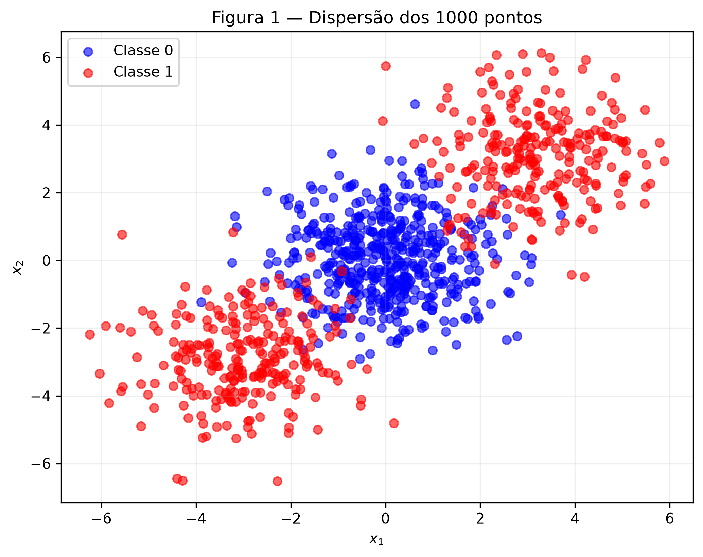
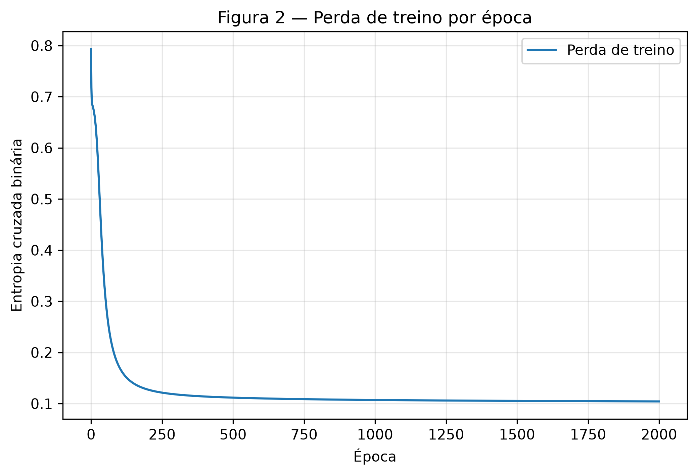
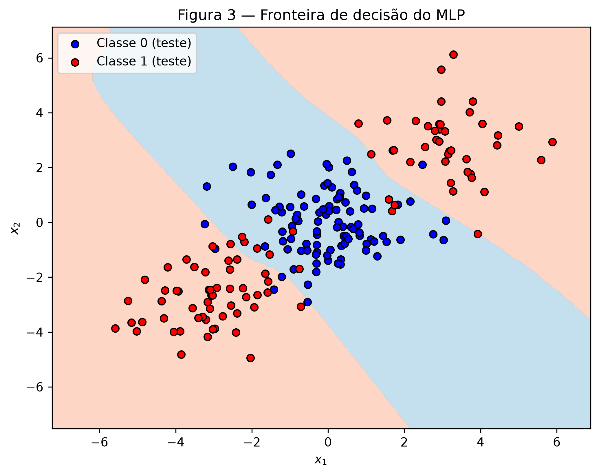
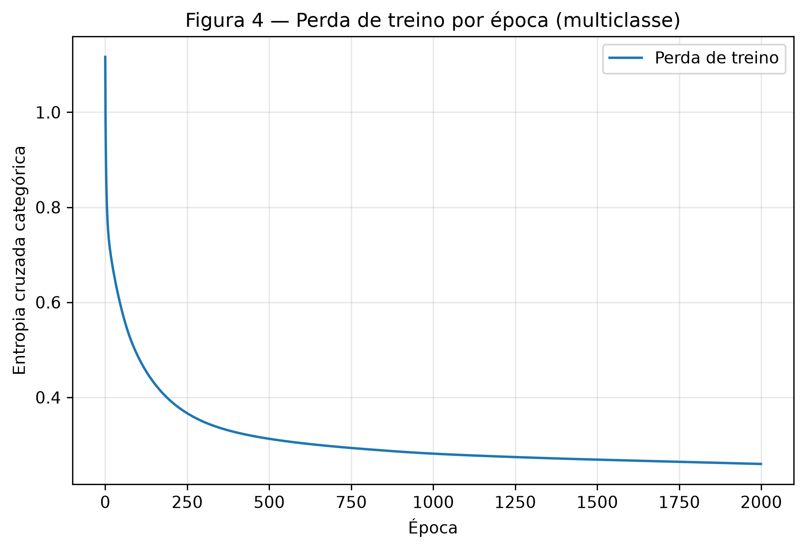
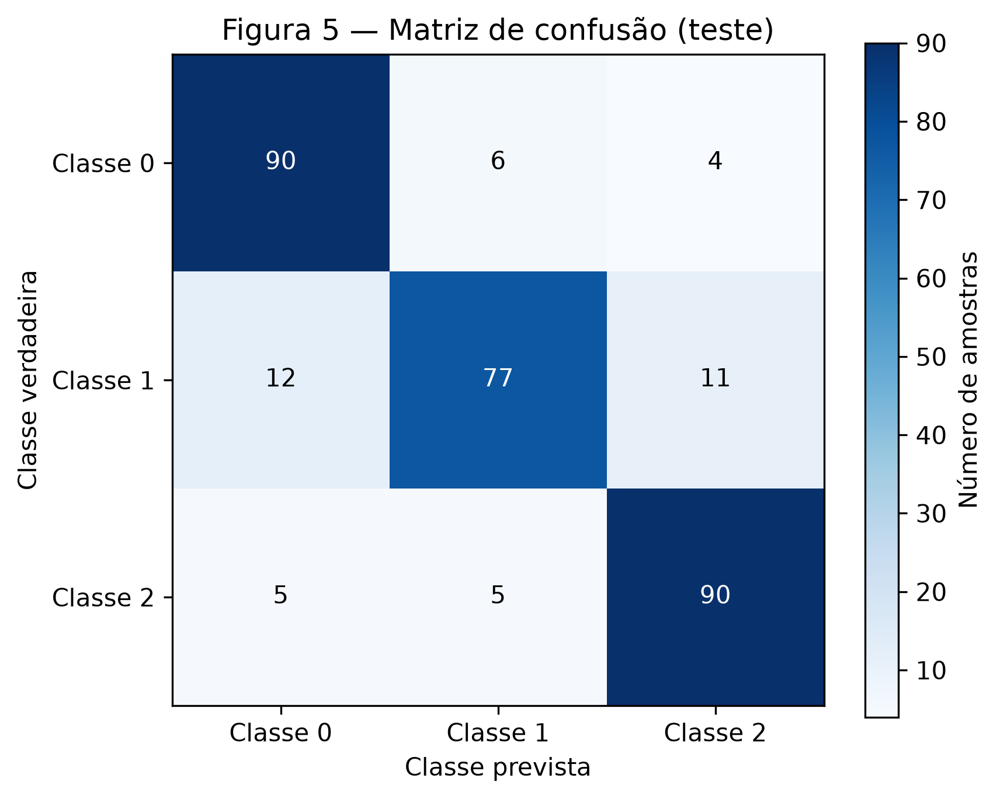
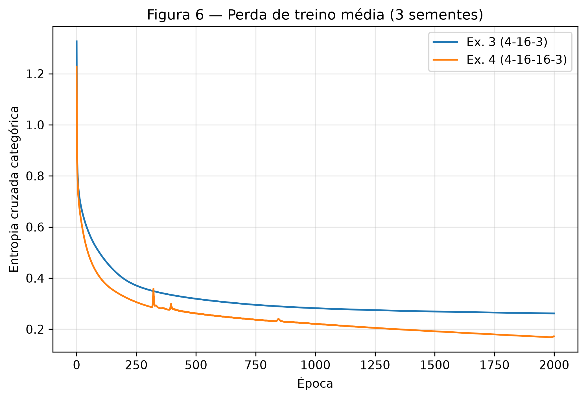

# 3. MLP

!!! abstract "Enunciado"

    [Exercises → MLP](https://insper.github.io/ann-dl/pt/2026.2/exercises/mlp/){:target='_blank'}

## Exercise 1

### Abordagem

Foi considerada uma rede com 2 entradas, 1 camada oculta de 2 neurônios e 1 neurônio de saída, com \(\tanh\) nas duas camadas e perda quadrática sobre uma única amostra (\(N = 1\)). Um passo completo de retropropagação foi feito à mão: passagem direta, cálculo dos gradientes pela regra da cadeia e atualização dos parâmetros por gradiente descendente com \(\eta = 0.3\). Todos os valores foram conferidos com um script em NumPy.

### Dados

\[
\mathbf{x} = \begin{bmatrix} 0.5 \\ -0.2 \end{bmatrix},\quad y = 1.0,\quad
\mathbf{W}^{(1)} = \begin{bmatrix} 0.3 & -0.1 \\ 0.2 & 0.4 \end{bmatrix},\quad
\mathbf{b}^{(1)} = \begin{bmatrix} 0.1 \\ -0.2 \end{bmatrix}
\]

\[
\mathbf{W}^{(2)} = \begin{bmatrix} 0.5 & -0.3 \end{bmatrix},\quad b^{(2)} = 0.2,\quad \eta = 0.3
\]

### A - Passagem direta

**1. Pré-ativações ocultas**

\[
\mathbf{z}^{(1)} = \mathbf{W}^{(1)}\mathbf{x} + \mathbf{b}^{(1)}
\]

\[
z^{(1)}_1 = 0.3(0.5) + (-0.1)(-0.2) + 0.1 = 0.2700
\]

\[
z^{(1)}_2 = 0.2(0.5) + 0.4(-0.2) - 0.2 = -0.1800
\]

**2. Ativações ocultas**

\[
\mathbf{h}^{(1)} = \tanh(\mathbf{z}^{(1)}) = \begin{bmatrix} \tanh(0.27) \\ \tanh(-0.18) \end{bmatrix} = \begin{bmatrix} 0.2636 \\ -0.1781 \end{bmatrix}
\]

**3. Pré-ativação de saída**

\[
u^{(2)} = \mathbf{W}^{(2)}\mathbf{h}^{(1)} + b^{(2)} = 0.5(0.2636) + (-0.3)(-0.1781) + 0.2 = 0.3852
\]

**4. Saída e perda**

\[
\hat{y} = \tanh(0.3852) = 0.3672
\]

\[
L = (y - \hat{y})^2 = (1 - 0.3672)^2 = 0.4004
\]

### B - Passagem reversa

\[
\frac{\partial L}{\partial \hat{y}} = -2(y - \hat{y}) = -2(1 - 0.3672) = -1.2655
\]

**1. Gradiente na pré-ativação de saída**

Usando \(\tanh'(u) = 1 - \tanh^2(u) = 1 - \hat{y}^2\):

\[
\frac{\partial L}{\partial u^{(2)}} = \frac{\partial L}{\partial \hat{y}}\,(1 - \hat{y}^2) = -1.2655\,(1 - 0.3672^2) = -1.2655 \cdot 0.8651 = -1.0948
\]

**2. Gradientes da camada de saída**

\[
\frac{\partial L}{\partial \mathbf{W}^{(2)}} = \frac{\partial L}{\partial u^{(2)}}\,\mathbf{h}^{(1)\top} = -1.0948\begin{bmatrix} 0.2636 & -0.1781 \end{bmatrix} = \begin{bmatrix} -0.2886 & 0.1950 \end{bmatrix}
\]

\[
\frac{\partial L}{\partial b^{(2)}} = \frac{\partial L}{\partial u^{(2)}} = -1.0948
\]

**3. Propagando para a camada oculta**

\[
\frac{\partial L}{\partial \mathbf{h}^{(1)}} = \mathbf{W}^{(2)\top}\,\frac{\partial L}{\partial u^{(2)}} = \begin{bmatrix} 0.5 \\ -0.3 \end{bmatrix}(-1.0948) = \begin{bmatrix} -0.5474 \\ 0.3284 \end{bmatrix}
\]

\[
\frac{\partial L}{\partial \mathbf{z}^{(1)}} = \frac{\partial L}{\partial \mathbf{h}^{(1)}} \odot \left(1 - (\mathbf{h}^{(1)})^2\right) = \begin{bmatrix} -0.5474 \cdot 0.9305 \\ 0.3284 \cdot 0.9683 \end{bmatrix} = \begin{bmatrix} -0.5094 \\ 0.3180 \end{bmatrix}
\]

**4. Gradientes da camada oculta**

\[
\frac{\partial L}{\partial \mathbf{W}^{(1)}} = \frac{\partial L}{\partial \mathbf{z}^{(1)}}\,\mathbf{x}^\top = \begin{bmatrix} -0.5094 \\ 0.3180 \end{bmatrix}\begin{bmatrix} 0.5 & -0.2 \end{bmatrix} = \begin{bmatrix} -0.2547 & 0.1019 \\ 0.1590 & -0.0636 \end{bmatrix}
\]

\[
\frac{\partial L}{\partial \mathbf{b}^{(1)}} = \frac{\partial L}{\partial \mathbf{z}^{(1)}} = \begin{bmatrix} -0.5094 \\ 0.3180 \end{bmatrix}
\]

### C - Atualização dos parâmetros

Regra: \(\theta \leftarrow \theta - \eta\,\dfrac{\partial L}{\partial \theta}\), com \(\eta = 0.3\).

| Parâmetro | Antes | Gradiente | Depois |
|---|---|---|---|
| \(W^{(1)}_{11}\) | 0.3000 | -0.2547 | 0.3764 |
| \(W^{(1)}_{12}\) | -0.1000 | 0.1019 | -0.1306 |
| \(W^{(1)}_{21}\) | 0.2000 | 0.1590 | 0.1523 |
| \(W^{(1)}_{22}\) | 0.4000 | -0.0636 | 0.4191 |
| \(b^{(1)}_1\) | 0.1000 | -0.5094 | 0.2528 |
| \(b^{(1)}_2\) | -0.2000 | 0.3180 | -0.2954 |
| \(W^{(2)}_1\) | 0.5000 | -0.2886 | 0.5866 |
| \(W^{(2)}_2\) | -0.3000 | 0.1950 | -0.3585 |
| \(b^{(2)}\) | 0.2000 | -1.0948 | 0.5284 |

**A perda sobe ou desce?** Desce. Cada parâmetro foi movido no sentido oposto ao seu gradiente, que é a direção em que a perda diminui localmente. Como o passo \(\eta = 0.3\) é pequeno o suficiente, a aproximação linear vale e a perda cai. Refazendo a passagem direta com os novos parâmetros, \(\hat{y} = 0.7112\) e \(L = 0.0834\), contra \(0.4004\) antes.

### Código

``` { .python .copy .select linenums='1' title="docs/exercises/mlp/code/ex1_backprop.py" }
--8<-- "docs/exercises/mlp/code/ex1_backprop.py"
```

## Exercise 2

### Abordagem

Foram gerados 1000 pontos em três grupos: a Classe 0 no centro e a Classe 1 dividida em dois grupos em cantos opostos. Os dados foram separados em 80% para treino e 20% para teste. Primeiro, uma regressão logística foi usada como linha de base linear. Em seguida, foi treinado um MLP implementado do zero em NumPy, com passagem direta, perda, retropropagação e atualização dos parâmetros escritas à mão. A classe recebe os tamanhos das camadas como argumento, para ser reaproveitada nos Exercícios 3 e 4.

### A - Gere os dados

Os dados foram gerados com `make_blobs`, usando centros \((0, 0)\), \((3, 3)\) e \((-3, -3)\), com 500, 250 e 250 pontos, respectivamente, desvio padrão \(1.2\) e `random_state=42`. O primeiro grupo forma a Classe 0, e os outros dois formam a Classe 1 (\(y = 1\) se o grupo for diferente de 0). A divisão treino/teste usou `train_test_split` com `test_size=0.2`, `random_state=42` e `stratify=y`, resultando em 800 pontos de treino e 200 de teste.


/// caption
**Figura 1** — Dispersão dos 1000 pontos, coloridos pela classe.
///

### B - Estabeleça a linha de base

A linha de base foi uma regressão logística (`LogisticRegression`), treinada no conjunto de treino. Ela aprendeu pesos \([0.0296,\ 0.0015]\) e bias \(-0.0031\), e obteve **47,5%** de acurácia no teste.

### C - Implemente o MLP

| Item | Valor |
|---|---|
| Arquitetura | 2-8-1 (2 entradas, 8 neurônios ocultos, 1 saída) |
| Ativação oculta | \(\tanh\) |
| Ativação de saída | sigmoide |
| Perda | entropia cruzada binária |
| Inicialização | pesos \(\sim \mathcal{N}(0,\ 1/\sqrt{n_{in}})\), bias zero, `rng = np.random.default_rng(42)` |
| Taxa de aprendizado | \(\eta = 0.5\) |
| Épocas | 2000 (gradiente descendente com o conjunto de treino inteiro) |
| Perda de treino | \(0.7930 \rightarrow 0.1043\) |
| Acurácia no teste | **91,5%** |

A Figura 2 mostra a perda caindo ao longo das épocas, indicando que o treinamento convergiu. A Figura 3 mostra as regiões de decisão aprendidas, calculadas sobre uma grade de \(300 \times 300\) pontos, com os pontos de teste sobrepostos.


/// caption
**Figura 2** — Perda de treino × época do MLP binário.
///


/// caption
**Figura 3** — Fronteira de decisão do MLP sobre os pontos de teste.
///

### D - Análise

**Por que a linha de base fica abaixo de 50%.** A Classe 1 está dividida em dois grupos em cantos opostos do plano, um em torno de \((3, 3)\) e outro em torno de \((-3, -3)\), e a Classe 0 fica no meio, perto da origem. Uma fronteira linear só consegue dividir o plano em dois semiplanos. Para deixar os dois grupos da Classe 1 do mesmo lado, ela teria que cortar a Classe 0 ao meio. Na prática, cada grupo puxa a reta para um lado e um efeito anula o outro: os pesos aprendidos terminaram quase zerados (\([0.0296,\ 0.0015]\)), e a fronteira acabou passando bem no meio do grupo azul. Por isso, mais ou menos metade da Classe 0 e um grupo inteiro da Classe 1 ficam do lado errado, e o modelo não vai além de um chute. Os 47,5%, um pouco abaixo de 50%, são só variação do conjunto de teste.

**Por que o MLP passa de 90%.** Cada neurônio da camada oculta calcula \(\tanh(\mathbf{w}^\top\mathbf{x} + b)\), ou seja, diz de que lado de uma reta o ponto está. A camada de saída junta essas respostas. Com duas retas paralelas, a rede já consegue expressar algo como "é Classe 1 se estiver acima da primeira reta **ou** abaixo da segunda", que é justamente o que uma reta sozinha não dá conta de fazer. Com 8 neurônios, sobra espaço para as bordas se ajustarem melhor aos grupos e até ficarem levemente curvas. No fim, o MLP chegou a 91,5% de acurácia no teste.

**Forma da região da Classe 1.** Na Figura 3, dá para ver que a Classe 0 ocupa uma faixa diagonal em volta da origem, enquanto a Classe 1 aparece em duas regiões separadas, uma de cada lado dessa faixa. Ou seja, a região da Classe 1 é desconexa. Já o lado de uma reta é sempre um único semiplano, conexo, e por isso nenhuma fronteira linear conseguiria reproduzi-la. Os 8,5% de erro que sobram no MLP se concentram perto das bordas da faixa, onde os grupos se sobrepõem por causa do espalhamento (\(\sigma = 1.2\)). Esses pontos caíram no território da outra classe, e não existe fronteira que os acerte sem errar outros no lugar.

### Código

#### Implementação do MLP

``` { .python .copy .select linenums='1' title="docs/exercises/mlp/code/mlp.py" }
--8<-- "docs/exercises/mlp/code/mlp.py"
```

#### Geração e treinamento do Exercise 2

``` { .python .copy .select linenums='1' title="docs/exercises/mlp/code/ex2_binary.py" }
--8<-- "docs/exercises/mlp/code/ex2_binary.py"
```

## Exercise 3

### Abordagem

Foram geradas 1500 amostras com 4 atributos e 3 classes, cada classe formada por 2 grupos. A mesma classe `MLP` do Exercício 2 foi reaproveitada sem alterações, mudando apenas o tamanho da saída (3 unidades), a ativação de saída (softmax) e a perda (entropia cruzada categórica). O modelo foi avaliado pela acurácia no teste e pela matriz de confusão, e comparado com uma regressão logística como linha de base.

### A - Gere os dados

Os dados foram gerados com `make_classification`, usando `n_samples=1500`, `n_features=4`, `n_informative=4`, `n_redundant=0`, `n_repeated=0`, `n_classes=3`, `n_clusters_per_class=2`, `class_sep=1.0` e `random_state=42`. São 3 classes com 500 amostras cada, e cada classe é formada por 2 grupos, totalizando 6 grupos em um espaço de 4 dimensões. A divisão treino/teste usou `train_test_split` com `test_size=0.2`, `random_state=42` e `stratify=y`, resultando em 1200 amostras de treino e 300 de teste (100 por classe).

### B - Adapte a rede

Em relação ao Exercício 2, só a saída da rede mudou:

| | Exercício 2 | Exercício 3 |
|---|---|---|
| Unidades de saída | 1 | 3 (uma por classe) |
| Ativação de saída | sigmoide | softmax |
| Perda | entropia cruzada binária | entropia cruzada categórica |
| Alvo | \(y \in \{0, 1\}\) | \(\mathbf{y}\) em one-hot |

A softmax transforma as pré-ativações de saída \(\mathbf{u} = (u_1, u_2, u_3)\) em probabilidades que somam 1:

\[
\hat{y}_k = \frac{e^{u_k}}{\sum_j e^{u_j}}
\]

e a entropia cruzada categórica, para uma amostra com alvo one-hot \(\mathbf{y}\), é:

\[
L = -\sum_k y_k \log \hat{y}_k
\]

**Derivação de \(\partial L / \partial u_i\).** Tomando o log da softmax:

\[
\log \hat{y}_k = u_k - \log \sum_j e^{u_j}
\]

Substituindo na perda:

\[
L = -\sum_k y_k u_k + \Big(\sum_k y_k\Big) \log \sum_j e^{u_j}
\]

Como \(\mathbf{y}\) é one-hot, \(\sum_k y_k = 1\), então:

\[
L = -\sum_k y_k u_k + \log \sum_j e^{u_j}
\]

Derivando em relação a \(u_i\): o primeiro termo dá \(-y_i\), e o segundo dá \(\dfrac{e^{u_i}}{\sum_j e^{u_j}} = \hat{y}_i\). Portanto:

\[
\boxed{\frac{\partial L}{\partial u_i} = \hat{y}_i - y_i}
\]

Esse é o mesmo gradiente obtido no Exercício 2 com sigmoide e entropia cruzada binária (\(\partial L/\partial u = \hat{y} - y\)). Por isso, o início da retropropagação é idêntico nos dois casos.

**Reaproveitamento do código.** O arquivo `mlp.py` não foi alterado entre os Exercícios 2 e 3: os métodos `forward`, `backward` e `update` são exatamente os mesmos. A única diferença está nos argumentos passados à classe:

```python
model = MLP(layer_sizes=[4, 16, 3], rng=rng, learning_rate=0.5, epochs=2000, output="softmax")
```

Com `output="softmax"`, a classe aplica softmax na última camada, usa a entropia cruzada categórica e converte os rótulos para one-hot. O `backward` começa com \(\boldsymbol{\delta} = (\hat{\mathbf{y}} - \mathbf{y})/N\) nos dois exercícios, conforme a derivação acima.

### C - Treine e avalie

| Item | Valor |
|---|---|
| Arquitetura | 4-16-3 (4 entradas, 16 neurônios ocultos, 3 saídas) |
| Ativação oculta | \(\tanh\) |
| Ativação de saída | softmax |
| Perda | entropia cruzada categórica |
| Inicialização | pesos \(\sim \mathcal{N}(0,\ 1/\sqrt{n_{in}})\), bias zero, `rng = np.random.default_rng(42)` |
| Taxa de aprendizado | \(\eta = 0.5\) |
| Épocas | 2000 (gradiente descendente com o conjunto de treino inteiro) |
| Perda de treino | \(1.1166 \rightarrow 0.2597\) |
| Acurácia no teste | **85,67%** |

A acurácia ficou dentro da faixa esperada (83–86%). A Figura 4 mostra a perda de treino caindo ao longo das épocas, e a Figura 5 mostra a matriz de confusão no conjunto de teste: a diagonal (90, 77 e 90) corresponde aos acertos de cada classe, e a Classe 1 é a que tem mais erros.



/// caption
**Figura 4** — Perda de treino × época do modelo multiclasse.
///


/// caption
**Figura 5** — Matriz de confusão no conjunto de teste.
///

### D - Análise

**Par mais confundido.** Pela Figura 5, o par que o modelo mais confunde é Classe 0 ↔ Classe 1 (6 + 12 = 18 erros), seguido de perto por Classe 1 ↔ Classe 2 (11 + 5 = 16). Já Classe 0 ↔ Classe 2 é o par menos confundido (4 + 5 = 9). A Classe 1 é a que tem menos acertos (77 de 100), já que é trocada tanto pela Classe 0 quanto pela Classe 2.

Isso tem a ver com a estrutura dos dados. O `make_classification` coloca os 6 grupos (3 classes × 2 grupos) perto dos vértices de um hipercubo em 4 dimensões, com coordenadas próximas de \(\pm 1\). Estimando os centros dos grupos com K-means, dá para ver que um dos grupos da Classe 1 difere de um grupo da Classe 0 em apenas uma coordenada, e o outro grupo da Classe 1 difere de um grupo da Classe 2 também em uma só. Ou seja, são vértices vizinhos, e os pontos acabam se sobrepondo na fronteira entre eles. Os grupos da Classe 0 e da Classe 2, por outro lado, diferem em pelo menos duas coordenadas e ficam mais afastados. É por isso que a Classe 1 fica "no meio" e concentra a maior parte dos erros.

**Linha de base.** A regressão logística chegou a **66,33%** no teste, contra **85,67%** do MLP, um ganho de cerca de 19 pontos percentuais.

**O que a camada oculta acrescentou.** Assim como no Exercício 2, cada classe é formada por dois grupos separados. Um modelo linear atribui a cada classe uma única região delimitada por hiperplanos, então não consegue cercar dois grupos distantes da mesma classe sem acabar incluindo grupos de outras classes no caminho. A camada oculta resolve isso combinando várias fronteiras lineares (cada neurônio define um hiperplano), o que permite isolar cada grupo separadamente. Os erros que sobram ficam justamente onde grupos vizinhos de classes diferentes se sobrepõem.

### Código

``` { .python .copy .select linenums='1' title="docs/exercises/mlp/code/ex3_multiclass.py" }
--8<-- "docs/exercises/mlp/code/ex3_multiclass.py"
```

## Exercise 4

### Abordagem

Foram usados os mesmos dados, a mesma divisão treino/teste, a mesma taxa de aprendizado (\(\eta = 0.5\)) e o mesmo número de épocas (2000) do Exercício 3. A única mudança foi a profundidade: uma segunda camada oculta de 16 neurônios. Para que a comparação não dependesse de uma inicialização específica, as duas redes foram treinadas com 3 sementes (42, 43 e 44). A semente altera apenas a inicialização dos pesos (`np.random.default_rng(seed)`); os dados continuam fixos com `random_state=42`. Os resultados reportados são as médias das 3 execuções.

### A - Treine a rede mais profunda

| Item | Valor |
|---|---|
| Arquitetura | 4-16-16-3 (4 entradas, duas camadas ocultas de 16 neurônios, 3 saídas) |
| Ativações | \(\tanh\) nas duas camadas ocultas, softmax na saída |
| Perda | entropia cruzada categórica |
| Taxa de aprendizado / épocas | \(\eta = 0.5\), 2000 épocas |
| Acurácia no teste por semente (42, 43, 44) | 85,33%, 84,67%, 85,67% |
| **Acurácia no teste (média)** | **85,22% ± 0,42%** |

### B - Compare


/// caption
**Figura 6** — Perda de treino média (3 sementes) das redes do Exercício 3 e do Exercício 4.
///

| Rede | Camadas ocultas | Nº de parâmetros | Perda final de treino (média) | Acurácia no teste (média ± dp) |
|---|---|---|---|---|
| Ex. 3 (4-16-3) | 1 | 131 | 0,2617 | 84,89% ± 0,87% |
| Ex. 4 (4-16-16-3) | 2 | 403 | 0,1723 | 85,22% ± 0,42% |

Diferença de acurácia (Ex. 4 − Ex. 3): **+0,33 ponto percentual**.

Os parâmetros foram contados como \(\sum (n_{in} \cdot n_{out} + n_{out})\) por camada. Por exemplo, a rede do Ex. 3 tem \((4 \cdot 16 + 16) + (16 \cdot 3 + 3) = 80 + 51 = 131\).

### C - Análise

**A rede mais profunda praticamente empatou.** A diferença de +0,33 ponto é menor que a variação entre sementes da própria rede rasa (desvio padrão de 0,87 ponto). Por exemplo, a rede rasa com semente 42 (85,67%) superou a rede profunda com semente 43 (84,67%). Não há evidência de que a segunda camada melhore a classificação, mesmo com cerca de 3 vezes mais parâmetros (403 contra 131).

**Complexidade da fronteira.** Os dados têm 6 grupos, perto dos vértices de um hipercubo em 4 dimensões. Para separá-los basta isolar cada grupo da vizinhança, o que uma única camada oculta com 16 hiperplanos já consegue fazer. A fronteira necessária não é complexa a ponto de exigir composição de características. O que limita a acurácia (cerca de 85%) é a sobreposição entre grupos vizinhos de classes diferentes, e nenhuma arquitetura separa pontos que estão misturados no mesmo lugar do espaço.

**O que a segunda camada acrescenta e o que custa.** A segunda camada permite combinar as regiões da primeira e formar fronteiras mais elaboradas, mas aumenta o número de parâmetros e torna a otimização mais difícil: o gradiente precisa atravessar mais uma derivada do \(\tanh\), e a superfície de perda fica mais irregular. Isso aparece na Figura 6: a curva da rede profunda tem picos (por volta das épocas 320, 400 e 850), sinal de passos instáveis com \(\eta = 0.5\), enquanto a curva da rede rasa é suave.

**Perda de treino e acurácia contam histórias diferentes.** A rede profunda atingiu uma perda de treino bem menor (0,1723 contra 0,2617), mas isso não se converteu em acurácia no teste. A capacidade extra foi usada para ajustar melhor o conjunto de treino, inclusive os pontos na região de sobreposição, o que não generaliza para pontos novos. Uma perda de treino menor indica um ajuste mais apertado aos dados vistos, não necessariamente um modelo melhor.

**Que tipo de dado recompensaria a profundidade.** Dados com estrutura hierárquica ou composicional, em que as características úteis são combinações de combinações: por exemplo, imagens (bordas → formas → objetos), ou fronteiras muito mais complexas, com muitos grupos entrelaçados, que exigiriam um número enorme de neurônios numa única camada. Também ajudaria ter mais dados, para que a capacidade extra fosse usada em padrões reais em vez de ruído.

### Código

``` { .python .copy .select linenums='1' title="docs/exercises/mlp/code/ex4_depth.py" }
--8<-- "docs/exercises/mlp/code/ex4_depth.py"
```

## Results summary

| # | Quantidade | Valor |
|---|---|---|
| 1 | Ex. 1: \(\mathbf{z}^{(1)}\) e \(\mathbf{h}^{(1)}\) | \(\mathbf{z}^{(1)} = [0.2700,\ -0.1800]\), \(\mathbf{h}^{(1)} = [0.2636,\ -0.1781]\) |
| 2 | Ex. 1: \(u^{(2)}\), \(\hat{y}\) e \(L\) | \(0.3852\), \(0.3672\), \(0.4004\) |
| 3 | Ex. 1: parâmetros atualizados | \(\mathbf{W}^{(1)} = [[0.3764,\ -0.1306],[0.1523,\ 0.4191]]\), \(\mathbf{b}^{(1)} = [0.2528,\ -0.2954]\), \(\mathbf{W}^{(2)} = [0.5866,\ -0.3585]\), \(b^{(2)} = 0.5284\) |
| 4 | Ex. 2: acurácia da linha de base linear | 47,5% |
| 5 | Ex. 2: arquitetura e acurácia no teste | 2-8-1 (tanh / sigmoide), 91,5% |
| 6 | Ex. 3: arquitetura e acurácia no teste | 4-16-3 (tanh / softmax), 85,67% |
| 7 | Ex. 3: par de classes mais confundido | Classe 0 ↔ Classe 1 (18 erros) |
| 8 | Ex. 4: arquitetura e acurácia no teste | 4-16-16-3 (tanh / tanh / softmax), 85,22% (média de 3 sementes) |
| 9 | Ex. 4: diferença de acurácia em relação ao Ex. 3 (média de 3 sementes) | +0,33 ponto percentual (85,22% contra 84,89%) |

## Discussão

Os quatro exercícios formam uma sequência: o Exercício 1 mostra o mecanismo de aprendizado em um único passo, o Exercício 2 mostra por que a camada oculta é necessária, o Exercício 3 mostra que a mesma rede se estende para várias classes, e o Exercício 4 mostra que aumentar a profundidade nem sempre ajuda. Ao longo do trabalho, alguns pontos foram mais difíceis de entender e merecem registro.

**A retropropagação.** O ponto mais difícil foi entender o que a retropropagação faz de fato. No começo, as fórmulas do Exercício 1 pareciam uma sequência de contas sem sentido. O que ajudou foi interpretá-las como uma distribuição de "culpa": o erro é medido na saída e enviado de volta camada por camada, e a regra da cadeia diz quanto desse erro cabe a cada peso. Cada etapa multiplica a culpa recebida pela derivada da ativação (\(1 - \tanh^2\)) e pelos pesos que ligam as camadas. Fazer as contas à mão e depois ver que o método `backward` da classe `MLP` repete exatamente as mesmas operações dentro de um loop foi o que tornou a ideia concreta.

**O papel da camada oculta.** Também não era óbvio por que uma camada oculta permite fronteiras não lineares. A interpretação que ficou clara foi: cada neurônio oculto define um único hiperplano e responde de que lado dele o ponto está; a camada seguinte combina essas respostas. Com duas retas, já é possível descrever uma faixa ("acima de uma ou abaixo da outra"), algo que uma reta sozinha não faz. O número de neurônios (8 no Exercício 2) não corresponde ao número de regiões finais: ele só dá flexibilidade para ajustar e curvar as bordas.

**Softmax e entropia cruzada.** A derivação de \(\partial L/\partial u = \hat{y} - y\) parecia abstrata até ficar claro o seu significado: o gradiente empurra para cima a probabilidade da classe correta e para baixo as das outras, na proporção do erro. O fato de sigmoide com entropia cruzada binária levar ao mesmo resultado explica por que o código da rede pôde ser reaproveitado sem mudanças entre os Exercícios 2 e 3.

**Ler os resultados com cuidado.** Por fim, foi preciso aprender a não confiar em um único número. Na matriz de confusão, as linhas são as classes verdadeiras e as colunas as previstas, e os erros só fazem sentido quando relacionados à posição dos grupos no espaço. No Exercício 4, a perda de treino sugeria que a rede profunda era melhor, mas a acurácia no teste, avaliada com várias sementes, mostrou que a diferença estava dentro da variação aleatória.

## Conclusão

Um MLP aprende repetindo um ciclo simples (passagem direta, cálculo da perda, retropropagação e atualização dos pesos), e é a combinação de várias fronteiras lineares na camada oculta que permite separar dados que uma reta não separa: de 47,5% para 91,5% no Exercício 2 e de 66,33% para 85,67% no Exercício 3. Mais capacidade, porém, não é garantia de melhora: a segunda camada oculta reduziu a perda de treino sem ganho significativo no teste, porque a dificuldade do problema estava na sobreposição entre grupos e não na complexidade da fronteira.
