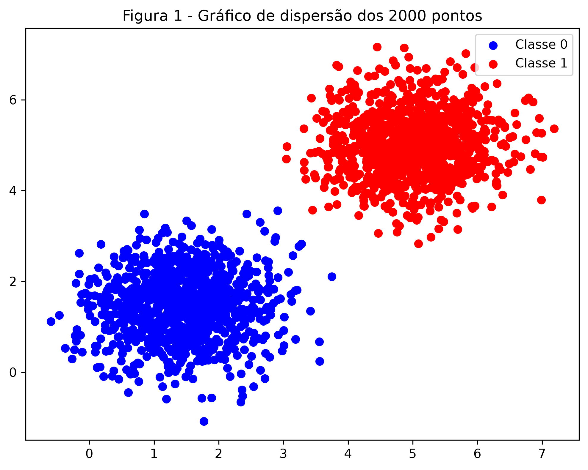
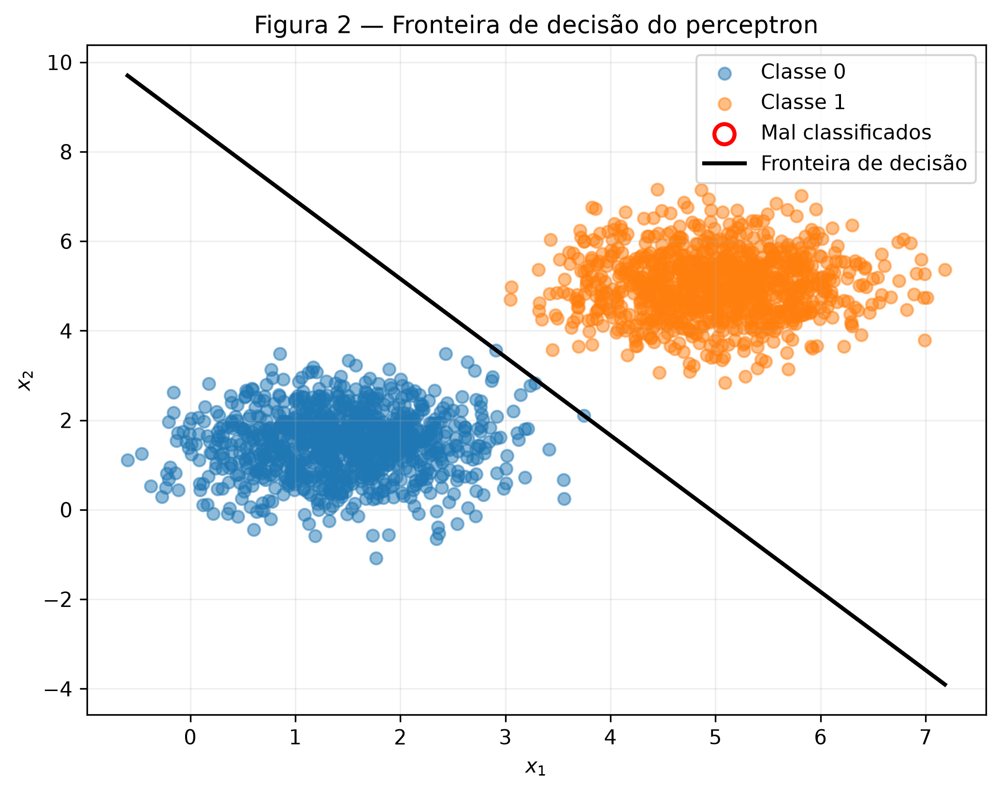
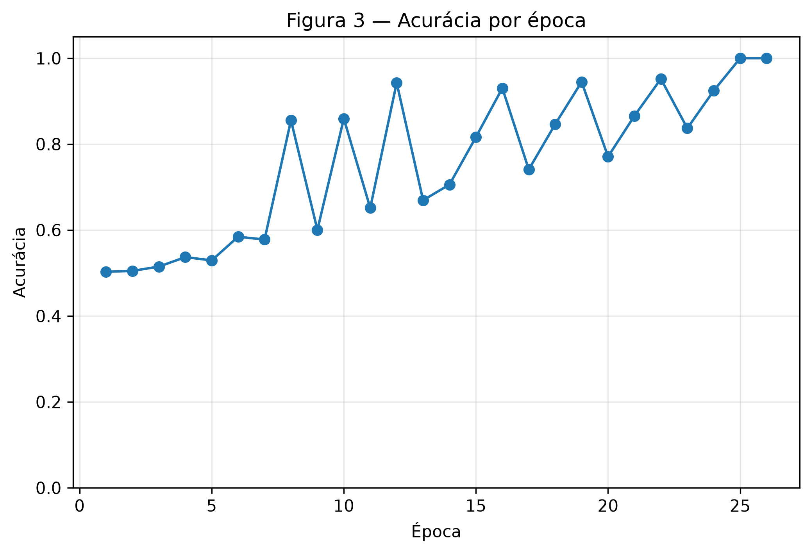
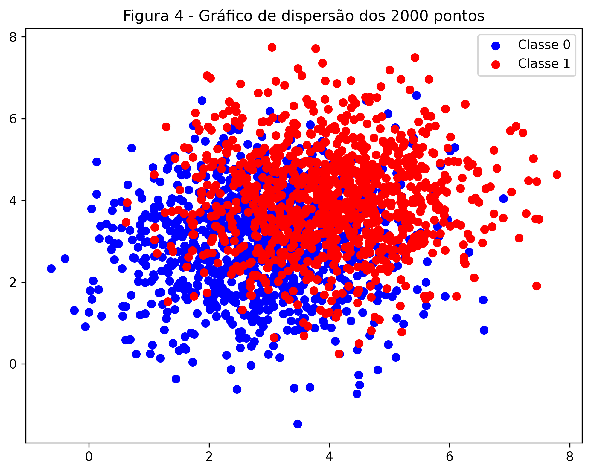
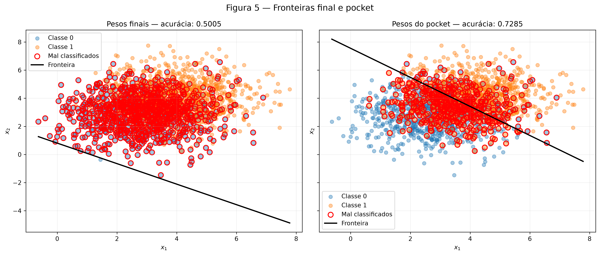
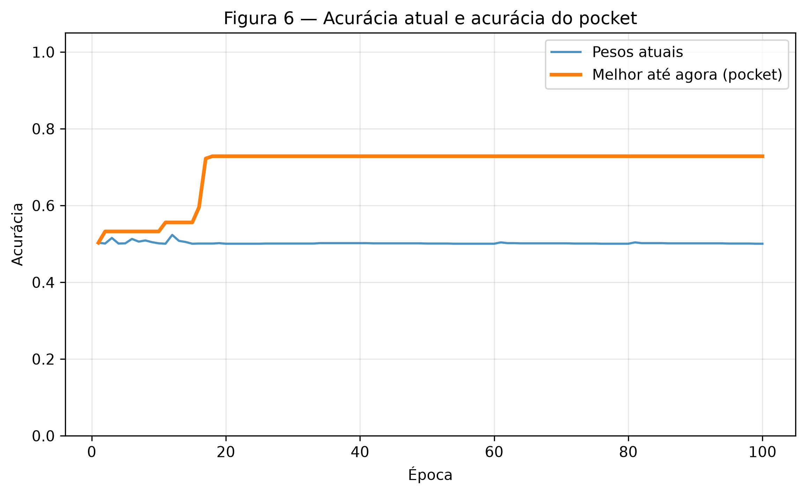

# 2. Perceptron

!!! abstract "Enunciado"

    [Exercises → Perceptron](https://insper.github.io/ann-dl/){:target='_blank'}


## Exercise 1

### A - Gere os dados

### Abordagem

Durante a execução do exercício 1, foram geradas duas classes: Classe 0 e Classe 1, com 1000 amostras cada a partir de distribuições normais multivariadas, utlizando as médias e a matriz de covariância definidas no enunciado. As amostras foram reunidas em uma matriz de atributos e classificadas por uma implementação própria do perceptron, com taxa de aprendizagem de **0.01** e limite de 100 épocas. Durante o treinamento, foram registradas a acurácia por época e as atualizações dos parâmetros. Por fim, foram visualizadas a distribuição dos dados, a fronteira de decisão e a evolução da acurácia.

### Código

#### Implementação do perceptron
``` { .python .copy .select linenums='1' title="docs/exercises/perceptron/code/perceptron_class.py" }
--8<-- "docs/exercises/perceptron/code/perceptron_class.py"
```

#### Geração e Treinamento do Exercise 1

``` { .python .copy .select linenums='1' title="docs/exercises/perceptron/code/exercise1_separatable_data.py" }
--8<-- "docs/exercises/perceptron/code/exercise1_separatable_data.py"
```

### Figuras


/// caption
**Figura 1** — Gráfico de Dispersão dos 2000 pontos.
///


/// caption
**Figura 2** — Fronteira de decisão do Perceptron
///


/// caption
**Figura 3** — Acurácia por Época
///

### Análise

1. Dados separáveis convergem rápido, pois existe uma reta capaz de separar corretamente todas as amostras das duas classes. A cada erro, o perceptron ajusta seus pesos e aproxima a fronteira dessa separação. Como há pouca ou nenhuma sobreposição entre as classes, as correções não entram constantemente em conflito. Assim que uma fronteira válida é encontrada, nenhuma nova atualização acontece e o treinamento termina. No caso do exercício, as médias \([1.5,1.5]\) e \([5,5]\) estão distantes, enquanto a variância é pequena. Por isso, os grupos ficam bem separados e o perceptron alcançou 100% de acurácia em apenas 26 épocas.

2. Os dois treinamentos alcançaram 100% de acurácia. Com \(\eta=0.01\), o perceptron convergiu em 34 épocas e produziu a direção normalizada \([0.8543,\ 0.5197]\). Com \(\eta=1.0\), convergiu em 37 épocas e produziu a direção \([0.8691,\ 0.4946]\). Portanto, aumentar a taxa não tornou a convergência necessariamente mais rápida. Como cada atualização soma \(\eta\mathbf{x}\) aos pesos, a taxa controla o tamanho dos passos em relação aos pesos iniciais, fazendo os treinamentos percorrerem trajetórias diferentes e encontrarem fronteiras ligeiramente distintas.

3. Caso os pesos e o bias começassem em zero, mudar a taxa de aprendizagem apenas aumentaria ou diminuiria proporcionalmente todos os valores aprendidos. Essa mudança de escala não alteraria as previsões, pois os pontos continuariam do mesmo lado da fronteira de decisão. Portanto, as atualizações aconteceriam na mesma ordem e os treinamentos levariam a mesma quantidade de épocas. É por isso que o exercício exige pesos iniciais aleatórios diferentes de zero: assim, a taxa de aprendizagem realmente pode influenciar o caminho do treinamento e a fronteira encontrada.

## Exercise 2

### Abordagem

Foram geradas duas classes parcialmente sobrepostas, com 1.000 amostras cada, utilizando as médias e a matriz de covariância definidas no enunciado. A mesma implementação do perceptron do Exercício 1 foi treinada por 100 épocas com taxa de aprendizagem de \(0.01\). Durante o treinamento, o algoritmo pocket guardou uma cópia dos pesos sempre que uma atualização produziu uma nova melhor acurácia. Ao final, foram comparados os pesos finais com os melhores pesos armazenados no pocket.

### Código

#### Geração e Treinamento do Exercise 2

``` { .python .copy .select linenums='1' title="docs/exercises/perceptron/code/exercise2_overlapping_data.py" }
--8<-- "docs/exercises/perceptron/code/exercise2_overlapping_data.py"
```

### Figuras


/// caption
**Figura 4** — Gráfico de Dispersão dos 2000 pontos com os dados do Exercício 2.
///


/// caption
**Figura 2** — Fronteiras Final e Pockets - lado a lado
///


/// caption
**Figura 3** — Acurácia do Atual vs Acurácia do Pocket
///

### Análise

1. Os pesos do pocket alcançaram 72,85% de acurácia porque preservaram a melhor fronteira encontrada, localizada entre as duas nuvens. Já a fronteira final ficou abaixo da maior parte dos pontos e passou a classificar quase todos como Classe 1, resultando em 50,05% de acurácia. Isso acontece porque, em cada erro, o bias muda apenas 0,01, enquanto os pesos mudam aproximadamente 0,05, pois os pontos possuem magnitude próxima de 5. Assim, cada atualização altera bastante a orientação da fronteira. Como as amostras estão organizadas por classe, as últimas amostras da Classe 1 determinam onde a fronteira fica ao término da época.

2. No Exercício 1, a acurácia chegou a 100% e estabilizou porque existia uma reta capaz de separar as classes. No Exercício 2, a curva dos pesos atuais continua oscilando, enquanto a do pocket estabiliza no melhor resultado já encontrado. O teorema da convergência garante que o perceptron encontrará uma solução em um número finito de atualizações apenas quando os dados forem linearmente separáveis. Como as classes deste exercício apresentam sobreposição, essa hipótese é violada e a convergência não é garantida.

3. Aumentar o número de épocas não resolve o problema, pois sempre existirão amostras sobrepostas que provocam novas atualizações. Quando o modelo corrige uma dessas amostras, pode passar a classificar incorretamente outra, mantendo o ciclo. Uma taxa de aprendizagem menor produziria alterações menores nos pesos e poderia mudar a trajetória ou a fronteira final, mas não eliminaria a sobreposição dos dados. Portanto, nem mais épocas nem uma taxa menor tornam o conjunto linearmente separável; o pocket apenas preserva a melhor solução encontrada durante esse processo.

## Results summary

| # | Quantidade | Valor |
|---:|------------|-------|
| 1 | Exercício 1 — $\mathbf{w}$ e $b$ finais | $\mathbf{w}=[0.05182464, \ 0.03152681]$; $b= -0.25$  |
| 2 | Exercício 1 — épocas até convergir | 34 |
| 3 | Exercício 1 — acurácia final | 100% |
| 4 | Exercício 1 — épocas e acurácia com $\eta=1.0$ | 37 épocas; 100% |
| 5 | Exercício 2 — $\mathbf{w}$ e $b$ finais | $\mathbf{w}=[0.03605737, \ 0.04942081]$; $b= -0.04$  |
| 6 | Exercício 2 — acurácia dos pesos finais | 0.5005 |
| 7 | Exercício 2 — acurácia dos pesos do *pocket* | 0.7285 |
| 8 | Exercício 2 — melhor época do *pocket* | 18 |

## Discussão

A principal dificuldade foi entender que os pesos finais não representam necessariamente a melhor solução encontrada durante o treinamento. No conjunto com sobreposição, o perceptron continuou corrigindo amostras conflitantes e terminou com uma acurácia muito inferior à registrada pelo pocket. A intuição também falhou ao supor que uma taxa de aprendizagem maior produziria convergência mais rápida, pois ela apenas aumentou o tamanho das atualizações e alterou a trajetória do treinamento. Em uma nova implementação, eu separaria desde o início os geradores usados nos dados e nos pesos, garantindo a mesma inicialização ao comparar diferentes taxas de aprendizagem.

## Conclusão

O exercício mostrou que a distribuição dos dados determina se uma fronteira linear é suficiente. Quando as classes estavam bem separadas, o perceptron encontrou rapidamente uma reta com 100% de acurácia. Quando as distribuições apresentaram sobreposição, nenhuma reta conseguiu separar todas as amostras, fazendo o treinamento oscilar sem convergir. Nesse caso, o pocket preservou a melhor solução linear, mas uma melhora adicional exigiria uma fronteira mais complexa, embora a própria sobreposição ainda imponha um limite à classificação.