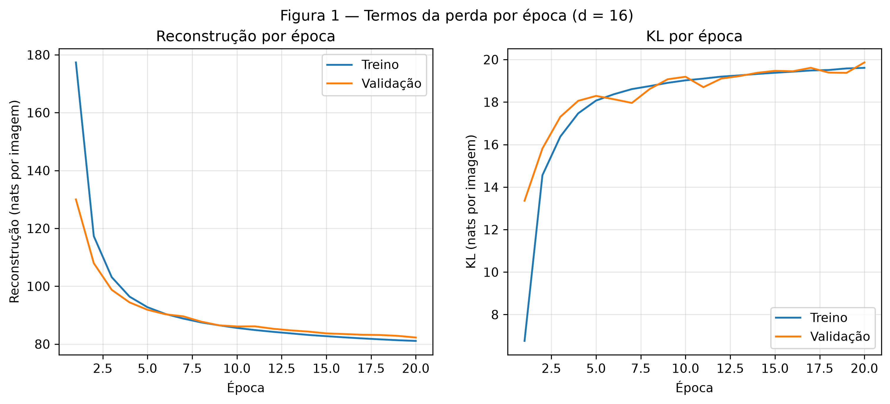
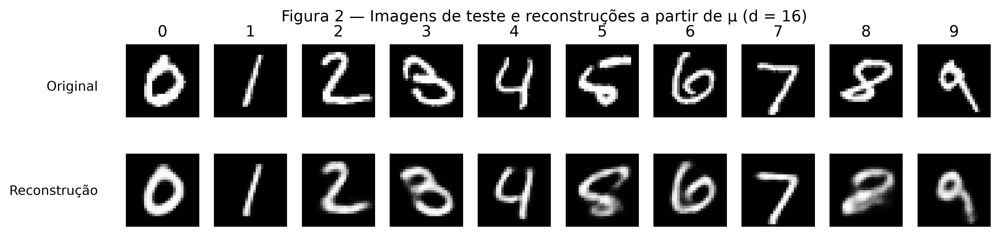
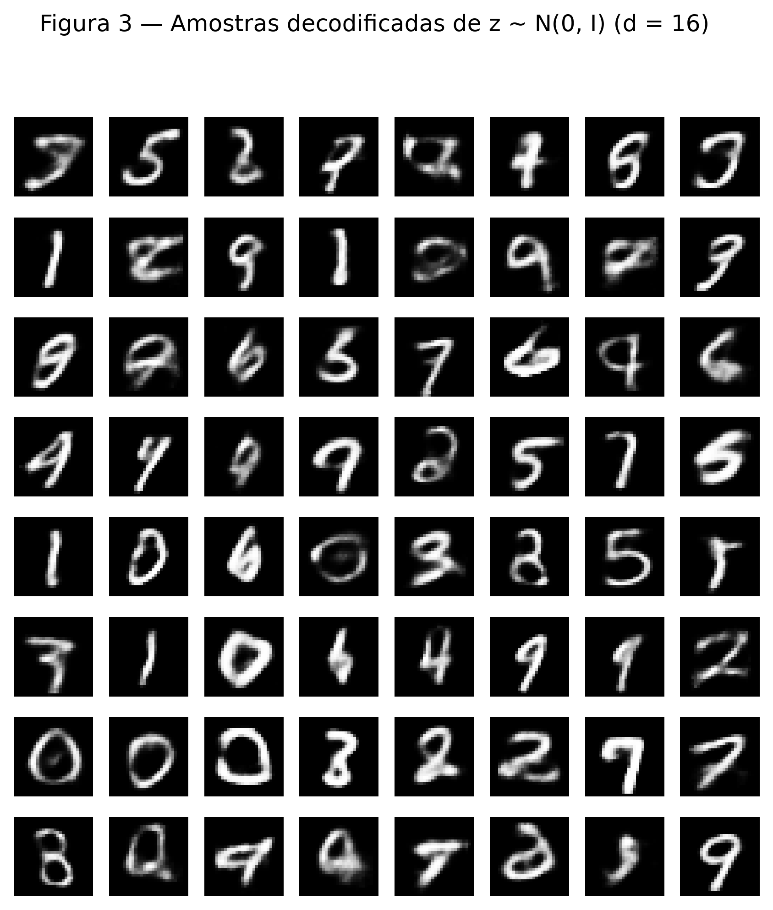
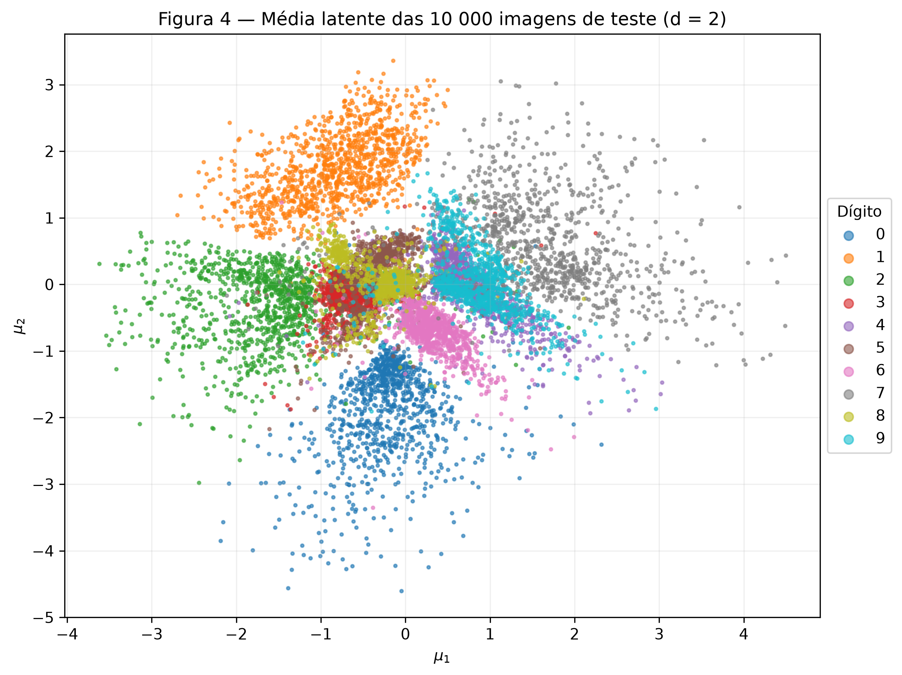
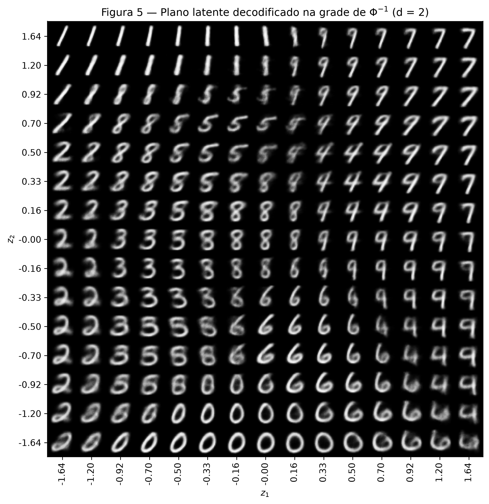
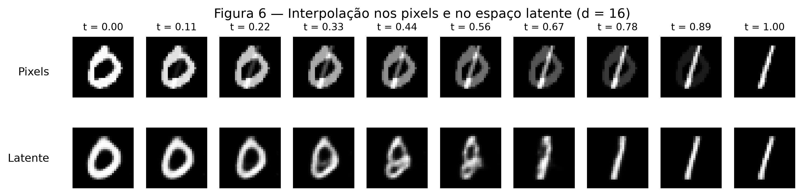

# 4. VAE

!!! abstract "Enunciado"

    [Exercises → VAE](https://insper.github.io/ann-dl/pt/2026.2/exercises/vae/){:target='_blank'}

## Exercise 1

### Abordagem

Foi treinado um autoencoder variacional no MNIST, com espaço latente de dimensão \(d = 16\). O encoder produz, para cada imagem, a média \(\boldsymbol{\mu}\) e o log da variância \(\log \boldsymbol{\sigma}^2\) de uma distribuição no espaço latente. O decoder reconstrói a imagem a partir de um ponto \(\mathbf{z}\) amostrado dessa distribuição. A perda soma a reconstrução e a divergência KL, e os dois termos foram registrados separadamente, em nats por imagem. O conjunto de teste foi usado apenas para os números finais. Todas as decisões de acompanhamento usaram a validação.

### A - Dados

O MNIST foi carregado pelo `torchvision`, com `transforms.ToTensor()`, que deixa os pixels em \([0, 1]\). As 60 000 imagens de treino foram divididas em **50 000 para treino e 10 000 para validação** com `random_split` e `torch.Generator().manual_seed(42)`. As 10 000 imagens oficiais de teste formam o conjunto de teste. As imagens são achatadas em vetores de 784 valores dentro do modelo, com `x.view(-1, 784)`.

### B - Modelo e perda

A semente `torch.manual_seed(42)` é chamada antes de construir o modelo.

| Parte | Estrutura |
|---|---|
| Encoder | 784 → 512 → 256, com ReLU após cada camada |
| Cabeças | duas camadas lineares 256 → \(d\), uma para \(\boldsymbol{\mu}\) e outra para \(\log \boldsymbol{\sigma}^2\) |
| Decoder | \(d\) → 256 → 512 → 784, com ReLU nas camadas ocultas e sigmoide na saída |
| Dimensão latente | \(d = 16\) |

**Reparametrização.** Amostrar \(\mathbf{z}\) diretamente impediria o gradiente de chegar ao encoder. Por isso, o sorteio é feito fora da rede:

\[
\mathbf{z} = \boldsymbol{\mu} + \boldsymbol{\sigma} \odot \boldsymbol{\varepsilon}, \qquad \boldsymbol{\varepsilon} \sim \mathcal{N}(\mathbf{0}, \mathbf{I})
\]

com \(\boldsymbol{\sigma} = \exp\left(\tfrac{1}{2}\log \boldsymbol{\sigma}^2\right)\). Assim, \(\mathbf{z}\) é uma função derivável de \(\boldsymbol{\mu}\) e \(\boldsymbol{\sigma}\), e a aleatoriedade fica em \(\boldsymbol{\varepsilon}\).

**Perda por imagem**, com \(\beta = 1\) e média sobre o lote:

\[
L = \underbrace{-\sum_{i=1}^{784} \left[ x_i \log \hat{x}_i + (1 - x_i) \log (1 - \hat{x}_i) \right]}_{\text{reconstrução}} + \beta \cdot \underbrace{\frac{1}{2} \sum_{j=1}^{d} \left( \mu_j^2 + \sigma_j^2 - 1 - \log \sigma_j^2 \right)}_{\text{KL}}
\]

A reconstrução usa `F.binary_cross_entropy(..., reduction="sum")` dividida pelo tamanho do lote. A KL foi escrita à mão, na forma fechada. O termo de reconstrução mede a fidelidade da imagem, e a KL aproxima cada distribuição latente de \(\mathcal{N}(\mathbf{0}, \mathbf{I})\), mantendo o espaço latente organizado.

### C - Treino

O treino usou Adam com taxa de aprendizado \(10^{-3}\), lotes de 128 e 20 épocas. Ao fim de cada época, a reconstrução e a KL foram registradas no treino (média da época) e na validação.

| Teste (\(d = 16\)) | Nats por imagem |
|---|---|
| Reconstrução | 81,49 |
| KL | 19,92 |
| ELBO negativo | 101,41 |

Os valores estão de acordo com a referência do enunciado (cerca de 81 e 20 nats). A KL de validação foi de 13,36 nats na época 1 para 19,87 nats na época 20. As curvas de treino e validação ficam próximas até o fim, sem sinal de sobreajuste relevante.


/// caption
**Figura 1** — Reconstrução e KL por época, no treino e na validação (\(d = 16\)).
///

### D - Reconstruções e amostras

A Figura 2 mostra a primeira imagem de teste de cada dígito e sua reconstrução, decodificando \(\boldsymbol{\mu}\). A Figura 3 mostra 64 imagens decodificadas de \(\mathbf{z} \sim \mathcal{N}(\mathbf{0}, \mathbf{I})\), com amostras sorteadas após `torch.manual_seed(0)`.


/// caption
**Figura 2** — Imagens de teste (em cima) e reconstruções a partir de \(\boldsymbol{\mu}\) (embaixo).
///


/// caption
**Figura 3** — Grade 8 × 8 de imagens decodificadas de \(\mathbf{z} \sim \mathcal{N}(\mathbf{0}, \mathbf{I})\).
///

### E - Análise

**1. Por que o otimizador paga mais KL no começo?** Na Figura 1, a KL de treino sobe de 6,76 para 19,61 nats, enquanto a reconstrução cai de 177,35 para 81,10 nats. Com KL perto de zero, as distribuições latentes seriam praticamente iguais ao prior, e \(\mathbf{z}\) não carregaria informação sobre a imagem. O decoder só conseguiria produzir uma imagem média. A KL mede quanta informação o encoder coloca em \(\mathbf{z}\), então pagar KL é o preço de passar essa informação ao decoder. O otimizador minimiza a soma, e a troca compensa: cerca de 13 nats a mais de KL foram acompanhados de uma queda de cerca de 96 nats na reconstrução. A subida desacelera quando cada nat extra de KL deixa de render uma queda equivalente na reconstrução.

**2. Por que a Figura 3 parece pior que a Figura 2?**

- **Onde as amostras caem no espaço latente.** Na Figura 2, cada \(\boldsymbol{\mu}\) vem de uma imagem real, então é uma região que o decoder conhece bem. Na Figura 3, \(\mathbf{z}\) vem do prior. A KL aproxima a distribuição dos códigos do prior, mas não de forma perfeita (ela vale 19,92 nats, não zero), e sobram regiões que o prior sorteia e que nenhuma imagem real ocupa. Nelas o decoder quase não foi treinado, e surgem formas que misturam dígitos, como várias da Figura 3.
- **O que o decoder produz para um dado \(\mathbf{z}\).** O decoder não sorteia uma imagem: ele devolve a média de uma distribuição de Bernoulli por pixel. Se vários traçados diferentes são compatíveis com o mesmo \(\mathbf{z}\), a BCE é minimizada pela média deles, o que gera bordas borradas. Em uma reconstrução, \(\boldsymbol{\mu}\) restringe bem a imagem. Em uma amostra do prior, a incerteza é maior, e a média fica mais borrada.

**3. Por que decodificar \(\boldsymbol{\mu}\) na Figura 2?** \(\boldsymbol{\mu}\) é o centro da distribuição latente da imagem, o melhor resumo que o encoder tem dela. Amostrar \(\mathbf{z}\) acrescentaria o ruído \(\boldsymbol{\sigma} \odot \boldsymbol{\varepsilon}\), que é útil no treino, mas aqui só tornaria a figura dependente do sorteio, sem mostrar melhor o que o modelo aprendeu.

### Código

#### Modelo, perda e treino

``` { .python .copy .select linenums='1' title="docs/exercises/vae/code/vae.py" }
--8<-- "docs/exercises/vae/code/vae.py"
```

#### Treinamento e figuras do Exercise 1

``` { .python .copy .select linenums='1' title="docs/exercises/vae/code/ex1_vae.py" }
--8<-- "docs/exercises/vae/code/ex1_vae.py"
```

## Exercise 2

### Abordagem

O mesmo modelo foi treinado com \(d = 2\), mantendo dados, semente, \(\beta\) e orçamento de treino, para que o espaço latente pudesse ser visualizado diretamente. Foram gerados o mapa do conjunto de teste codificado e a grade do plano decodificado. A interpolação compara o caminho nos pixels com o caminho no espaço latente, usando o modelo com \(d = 16\).

### A - VAE 2-D

| Teste | \(d = 16\) | \(d = 2\) |
|---|---|---|
| Reconstrução (nats) | 81,49 | 134,45 |
| KL (nats) | 19,92 | 6,68 |
| ELBO negativo (nats) | 101,41 | 141,13 |

Os valores de \(d = 2\) estão de acordo com a referência do enunciado (cerca de 135 e 7 nats). Com menos dimensões, o modelo transmite menos informação pelo espaço latente (KL menor) e reconstrói pior.

### B - Conjunto de teste codificado


/// caption
**Figura 4** — \(\boldsymbol{\mu}\) das 10 000 imagens de teste, coloridas por dígito (\(d = 2\)).
///

### C - Plano decodificado

Os 15 valores de cada eixo foram obtidos com \(z = \Phi^{-1}(q)\), com \(q\) igualmente espaçado em \([0.05,\ 0.95]\), usando `scipy.stats.norm.ppf`. O eixo \(z_2\) cresce para cima, no mesmo arranjo da Figura 4.

Esse espaçamento dá a cada célula a mesma massa do prior porque valores igualmente espaçados em \(q\) cobrem fatias de igual probabilidade da Normal: os pontos ficam mais juntos no centro, onde a densidade é alta, e mais afastados nas bordas, onde ela é baixa.


/// caption
**Figura 5** — Grade 15 × 15 de pontos latentes decodificados, nos quantis de \(\Phi^{-1}\) (\(d = 2\)).
///

### D - Interpolação

Foram escolhidas as imagens de teste de **índice 3 (dígito 0)** e **índice 2 (dígito 1)**. A linha de cima interpola nos pixels, \((1 - t)\mathbf{x}_a + t\mathbf{x}_b\). A linha de baixo decodifica \((1 - t)\boldsymbol{\mu}_a + t\boldsymbol{\mu}_b\) com o modelo \(d = 16\).


/// caption
**Figura 6** — Interpolação entre um 0 e um 1, nos pixels (em cima) e no espaço latente com \(d = 16\) (embaixo).
///

### E - Análise

**1. Quais dígitos se sobrepõem?** Na Figura 4, a maior sobreposição é entre **4 e 9**, que ocupam quase a mesma região, e há um segundo grupo misturado no centro, formado por **3, 5 e 8**. Isso foi confirmado contando os 20 vizinhos mais próximos de cada ponto: os pares mais misturados são 4 e 9 (12 975), 3 e 5 (6 527) e 5 e 8 (5 873). A Figura 5 mostra a mesma transição: à direita da grade, por volta de \(z_1 \approx 0.5\), um 9 se transforma em 4 quando \(z_2\) varia entre \(0\) e \(0.5\). As imagens do meio do caminho têm a haste de ambos e um topo ambíguo, nem claramente fechado como no 9, nem aberto como no 4. Faz sentido: os dois dígitos diferem por um detalhe pequeno de traço, que pesa pouco na reconstrução pixel a pixel.

**2. O que dois números por imagem obrigam o modelo a descartar?** Com apenas 2 números, o modelo precisa gastar quase toda a capacidade para indicar qual é o dígito e sua forma geral, como a inclinação. O restante do estilo individual, como espessura, traços específicos e irregularidades, é descartado. A Figura 5 é a evidência: cada região mostra uma versão genérica e suave do dígito, e o conjunto todo cabe em uma pequena variedade de formas, sem a diversidade de estilos dos dados reais. A reconstrução piora em cerca de 53 nats (de 81,49 para 134,45), porque esses detalhes passam a ser preenchidos pela média.

**3. Comparando as duas linhas da Figura 6.** A linha de pixels não passa por imagens que parecem dígitos: ela apenas sobrepõe o 0 e o 1 com intensidades diferentes, e o meio do caminho mostra as duas figuras ao mesmo tempo, como uma dupla exposição. A soma ponto a ponto de duas imagens não fica na região das imagens de dígitos. A linha latente é mais próxima de um traçado contínuo: o 0 se estreita gradualmente até virar um 1, porque o decoder transforma cada ponto do caminho em uma imagem com traço único. O resultado não é perfeito: em \(t = 0.44\) e \(t = 0.56\), as imagens são formas ambíguas, que não correspondem claramente a um dígito. Mesmo assim, as etapas próximas das pontas parecem dígitos, o que a linha de pixels não consegue.

### Código

``` { .python .copy .select linenums='1' title="docs/exercises/vae/code/ex2_vae.py" }
--8<-- "docs/exercises/vae/code/ex2_vae.py"
```

## Discussão

Os dois exercícios mostram lados do mesmo equilíbrio. A reconstrução pede códigos precisos, enquanto a KL pede códigos parecidos com o prior. No Exercício 1, esse equilíbrio aparece na subida da KL durante o treino. No Exercício 2, ele aparece quando a capacidade do espaço latente é reduzida: com \(d = 2\), a KL cai para 6,68 nats, e a reconstrução piora para 134,45 nats, mas o espaço pode ser visto diretamente.

A principal diferença em relação ao MLP é o objetivo. Em vez de prever um rótulo, o modelo aprende uma representação sem usar os rótulos: a organização por dígito na Figura 4 surge apenas da semelhança entre as imagens. Por isso, dígitos com forma parecida, como 4 e 9, ficam próximos.

## Conclusão

O VAE com \(d = 16\) reconstruiu o MNIST com 81,49 nats de reconstrução e 19,92 nats de KL, e gerou amostras novas a partir do prior, ainda que mais borradas e ambíguas que as reconstruções. Reduzir para \(d = 2\) piorou a reconstrução, mas revelou um espaço latente organizado, em que caminhar entre códigos produz transições mais plausíveis do que misturar pixels.

## Results summary

| # | Quantidade | Valor |
|---|---|---|
| 1 | Ex. 1: reconstrução, KL e ELBO negativo no teste (\(d = 16\)) | 81,49 nats, 19,92 nats, 101,41 nats |
| 2 | Ex. 1: KL de validação na primeira e na última época | 13,36 nats (época 1), 19,87 nats (época 20) |
| 3 | Ex. 2: reconstrução e KL no teste (\(d = 2\)) | 134,45 nats, 6,68 nats |
| 4 | Ex. 2: os dois índices de teste interpolados | 3 (dígito 0) e 2 (dígito 1) |
